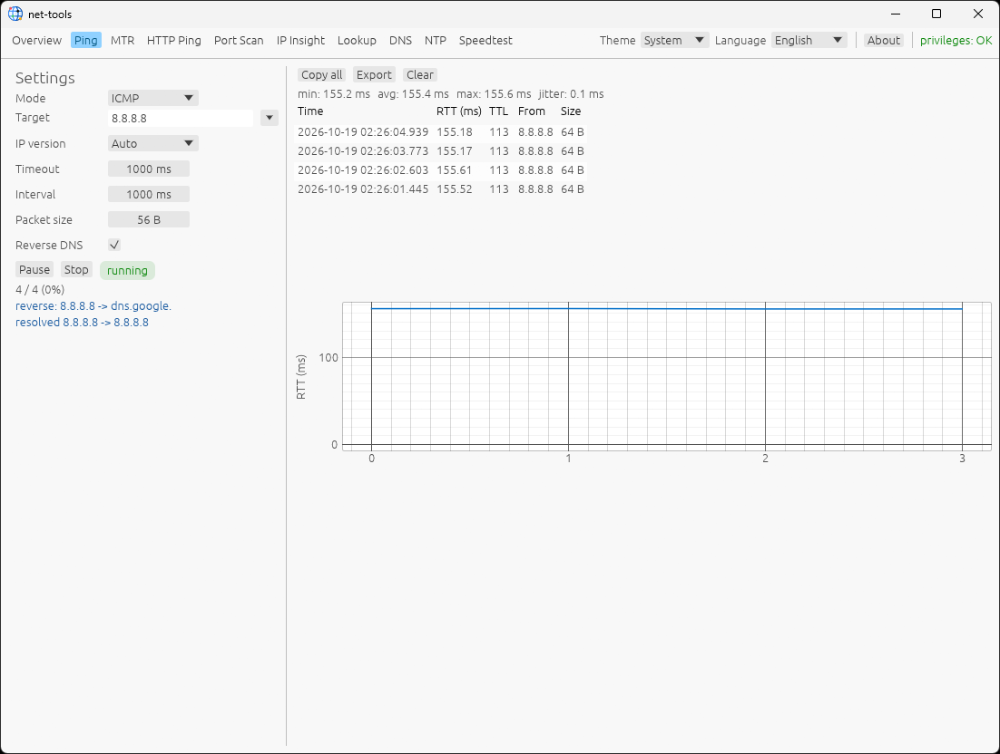
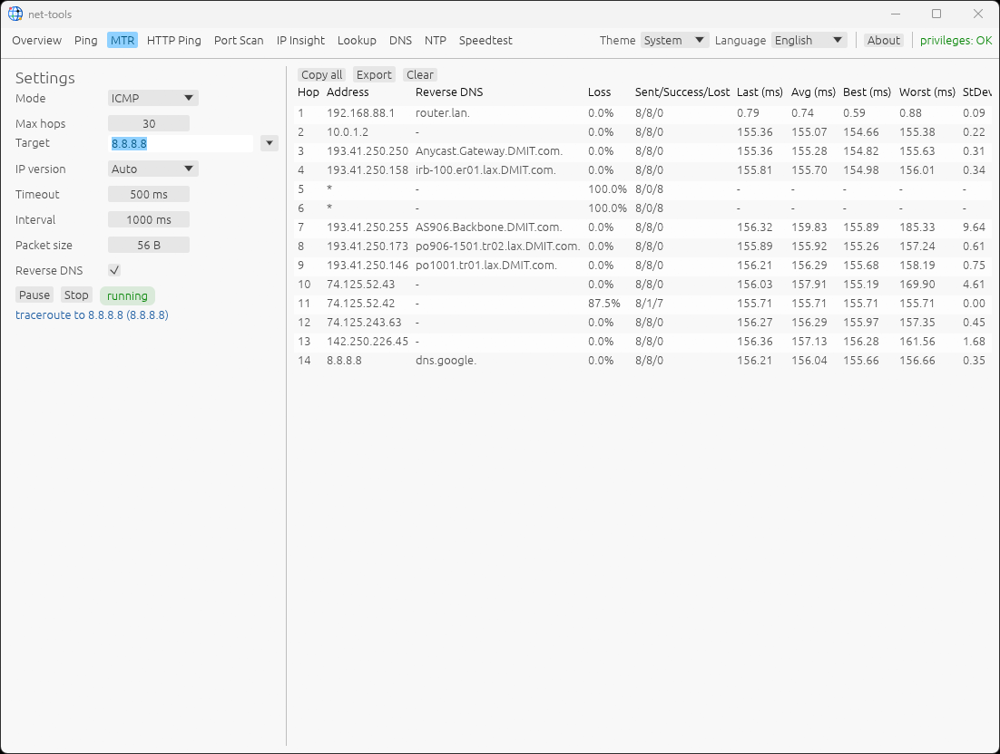
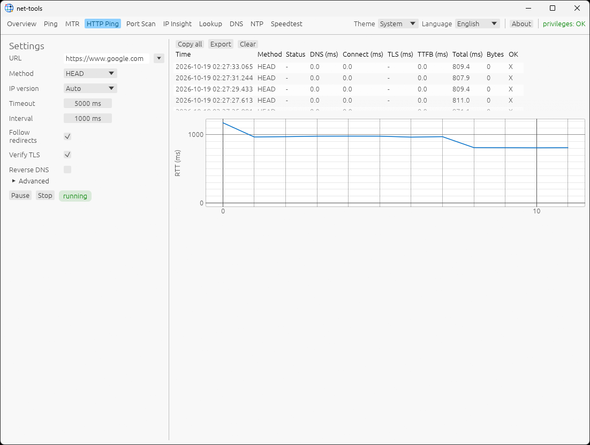
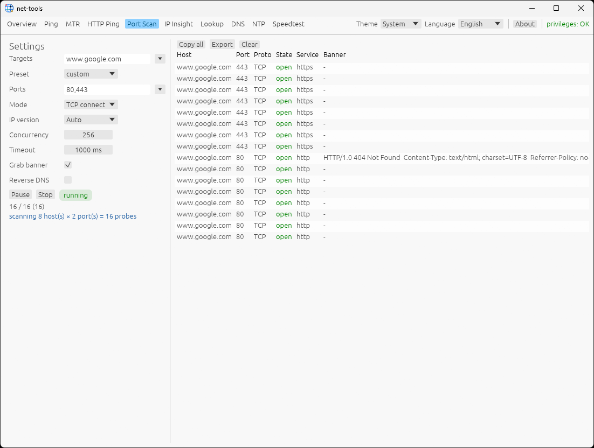
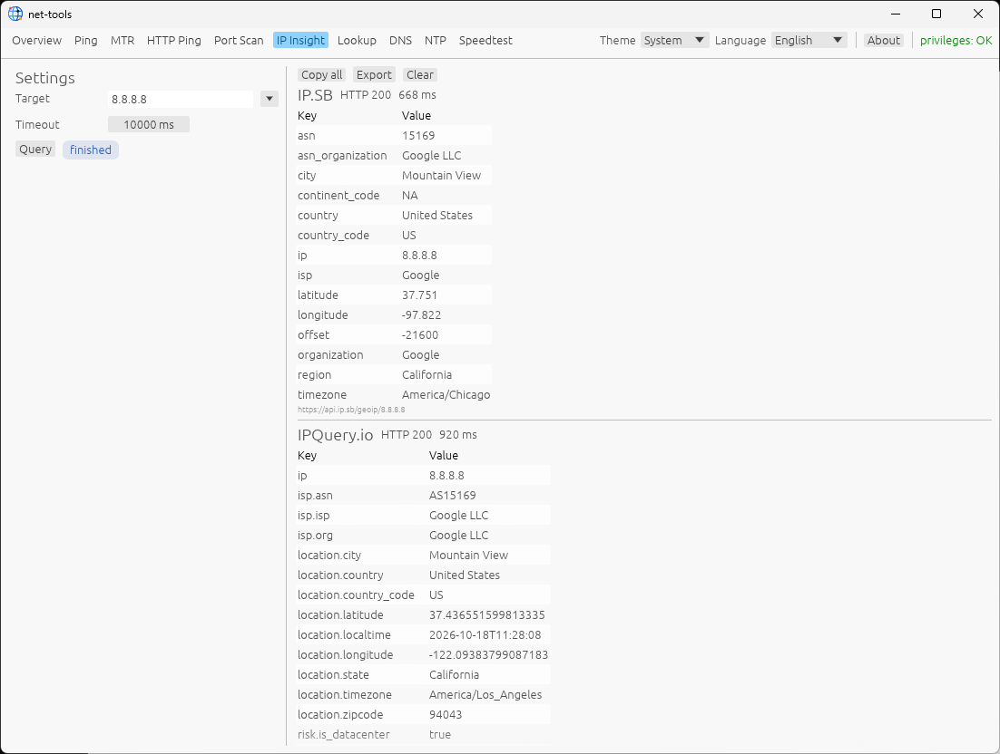
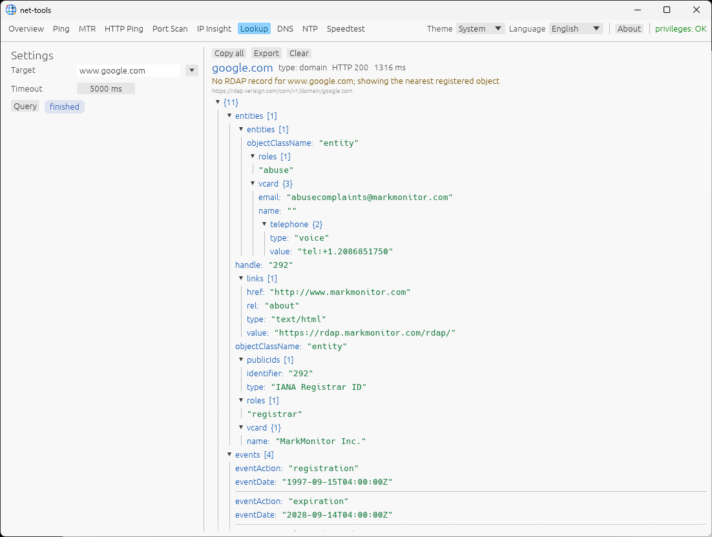
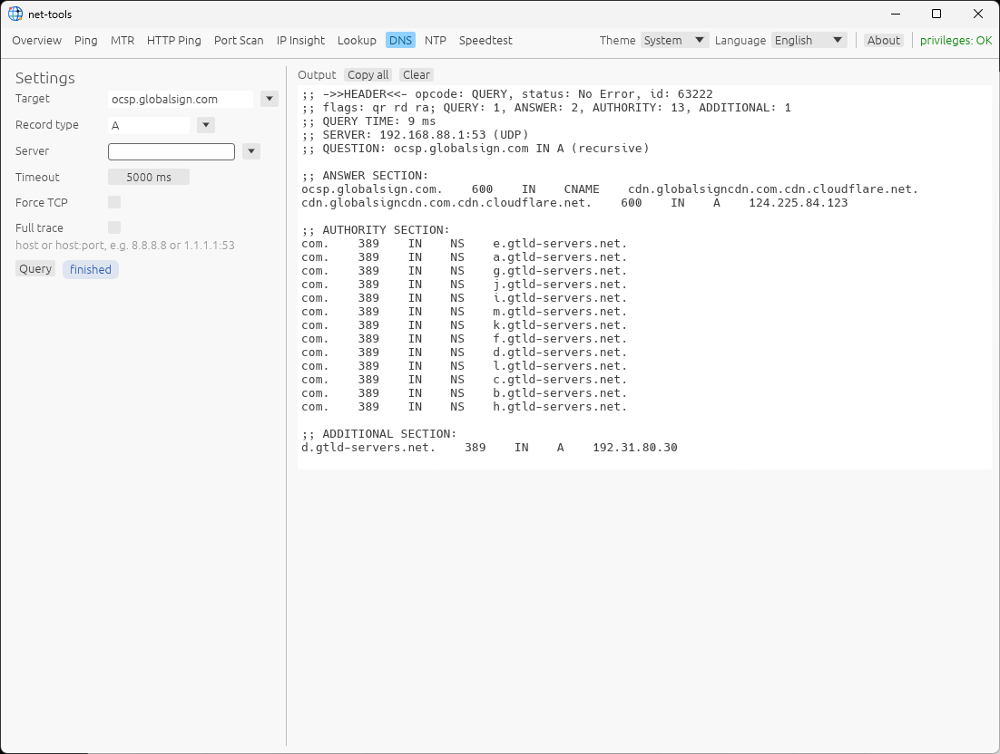
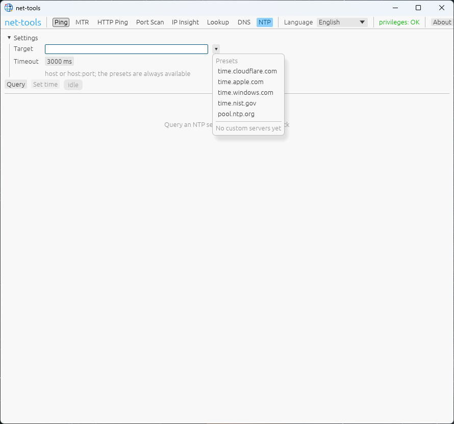
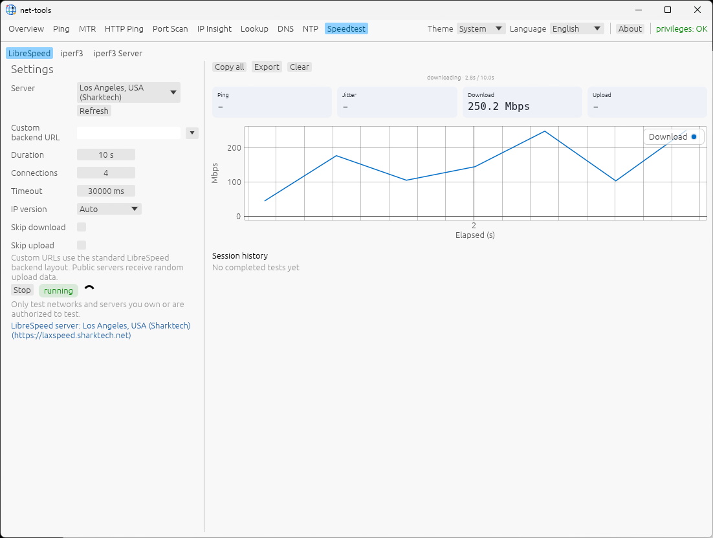

# net-tools

[](#license)

Cross-platform desktop network diagnostics for Windows, macOS and Linux, built
with Rust and egui. Each tool lives in its own tab, and concurrent probes run
independently.

## Disclaimer

Use this tool only on networks you own or are explicitly authorized to test.
Unauthorized scanning or probing may be illegal, and you are responsible for all
traffic and actions generated by the tool. The software is provided "as is",
without warranty; see the license. If you do not accept these terms, do not use
it.

## Features

| Tab | Highlights |
|-----|------------|
| Overview | Interfaces, addresses, gateways, DNS and routes; live RX/TX charts; public IPv4/IPv6 egress with location, ASN and ISP. |
| Ping | Continuous ICMP/UDP ping with live chart, loss, min/avg/max and jitter. |
| MTR | Parallel hop-by-hop probing with continuous refresh and multiple responders per hop. |
| HTTP Ping | Multi-method requests with DNS, connect, TLS, TTFB and total timings. |
| Port Scan | TCP connect, SYN half-open and UDP scans, with banner grabbing. |
| IP Insight | Parallel IP geolocation queries across multiple providers. |
| Lookup | RDAP domain/IP lookup with JSON tree, parsed contacts and parent-domain fallback. |
| DNS | dig-like queries, custom server, UDP with TCP fallback, and iterative trace from the root servers. |
| NTP | SNTP query, live analog clock, local/UTC time in milliseconds, server metrics, presets and optional system clock update. |
| Speedtest | LibreSpeed, iperf3 client and built-in iperf3 server; live throughput, RTT/jitter and TCP/UDP metrics. |

Continuous probes support **Start / Pause / Stop**; one-shot tools and servers
use **Start / Stop**. Pressing **Enter** in a target field restarts the task with
the new target.

## Screenshots

| Ping | MTR |
|------|-----|
|  |  |

| HTTP Ping | Port Scan |
|-----------|-----------|
|  |  |

| IP Insight | Lookup |
|------------|--------|
|  |  |

| DNS | NTP |
|-----|-----|
|  |  |

| Speedtest |
|-----------|
|  |

## Download and run

Download the package for your platform from
[GitHub Releases](https://github.com/playhard-pro/net-tools/releases). No Rust
toolchain is required.

### Which file?

| OS | Architecture | File |
|----|--------------|------|
| Linux | x86_64 / amd64 | `net-tools_<version>_linux_amd64.deb` or `.AppImage` |
| Linux | arm64 / aarch64 | `net-tools_<version>_linux_arm64.deb` or `.AppImage` |
| Windows | x64 | `net-tools_<version>_windows_x64.zip` |
| Windows | arm64 | `net-tools_<version>_windows_arm64.zip` |
| macOS | Apple Silicon (arm64) | `net-tools_<version>_macos_aarch64.dmg` |

`<version>` is the release version, for example `0.2.6`. Check your architecture
with `uname -m` on Linux/macOS (`x86_64`, `aarch64` or `arm64`), or under
*Settings → System → About → System type* on Windows.

### Linux

**deb** installs system-wide and registers with the package manager:

```bash
sudo apt install ./net-tools_<version>_linux_amd64.deb
```

If dependencies are missing, run `sudo dpkg -i <package>` followed by
`sudo apt-get -f install`. The package declares only the base C runtime; GUI
libraries may be needed (see
[Linux runtime dependencies](#linux-runtime-dependencies)).

**AppImage** is portable and needs no installation:

```bash
chmod +x net-tools_<version>_linux_amd64.AppImage
./net-tools_<version>_linux_amd64.AppImage
```

If FUSE is unavailable, install `libfuse2` or append
`--appimage-extract-and-run`.

### Windows

Extract the zip and run `net-tools.exe`. Use **Run as administrator** for
raw-socket probes. SmartScreen may warn because the archive is not code-signed;
choose *More info → Run anyway* if you trust the source.

### macOS

Open the dmg, drag `net-tools.app` into *Applications*, then launch it. Releases
are signed and notarized when the Apple secrets are configured; otherwise the
app is ad-hoc signed and macOS asks for confirmation under
*System Settings → Privacy & Security → Open Anyway*. If an older build reports
that the app **is damaged**, clear the quarantine attribute:

```bash
sudo xattr -dr com.apple.quarantine /Applications/net-tools.app
```

Raw-socket probes require `sudo` (see
[Privileges](#privileges-unprivileged-best-effort)).

### First run

Features start unprivileged except raw-socket probes. The status bar reports any
missing capability, and `copy cmd` offers the matching authorization command.

## Build and run

Requires stable Rust ([rustup](https://rustup.rs)):

```bash
cargo run --release -p net-tools
```

### Linux runtime dependencies

Install X11/Wayland and OpenGL client libraries, for example on Debian/Ubuntu:

```bash
sudo apt-get install -y libxkbcommon0 libxkbcommon-x11-0 libxcursor1 libxi6 \
  libxrandr2 libxfixes3 libxinerama1 libwayland-client0 libgl1 libegl1 xkb-data
```

Windows and macOS need no extra libraries.

## Privileges (unprivileged, best effort)

Raw-socket features show a clear message when permissions are missing:

| Platform | Available unprivileged | Requires privileges |
|----------|------------------------|---------------------|
| Linux | ICMP ping (ping socket), UDP ping, TCP connect scan | ICMP MTR, SYN scan, UDP MTR |
| macOS | UDP ping, TCP connect scan | ICMP, MTR, SYN |
| Windows | ICMP ping (system API) | SYN scan, UDP MTR |

### Granting privileges

- **Linux**: grant only the required capabilities instead of running as root:

  ```bash
  sudo setcap cap_net_raw,cap_sys_time+ep "$(readlink -f "$(which net-tools)")"
  ```

  `cap_sys_time` is only needed by NTP **Set time**; network probes need
  `cap_net_raw`. Alternatively run `sudo ./net-tools`.
- **macOS**: `sudo ./net-tools`.
- **Windows**: right-click and choose **Run as administrator**.

The status bar tracks probing and raw-socket capabilities separately and only
shows permission hints for real permission errors.

## Packaging

Linux and macOS packages use
[cargo-packager](https://github.com/crabnebula-dev/cargo-packager). Windows uses
a zip so the executable can run elevated. Artifacts are written to `dist/`, and
each architecture is packaged on a native runner.

```bash
cargo install cargo-packager --locked
cargo build --release

# Linux (x86_64 and arm64)
cargo packager -c packager.toml -f deb,appimage   # needs patchelf squashfs-tools file
# macOS (Apple Silicon)
bash scripts/package_macos.sh
# Windows (x86_64 and arm64)
pwsh scripts/package_windows.ps1 -Arch x64
pwsh scripts/package_windows.ps1 -Arch arm64
```

The macOS script creates the dmg from the verified app after signing.

### Application icon

The master icon is `assets/icon.png`. After replacing it:

```bash
cp new-icon.png assets/icon.png
python3 scripts/generate_icons.py   # writes assets/icon.ico
cargo build --release
cargo packager -c packager.toml -f deb,appimage
bash scripts/package_macos.sh
```

The PNG is used at runtime and by Linux/macOS packaging; the ICO is embedded in
the Windows executable by `crates/app/build.rs`.

## Cross-compilation

Cross-compilation builds only the executable. Packages still require native
tooling, so releases are built on native CI runners.

### Windows (MSVC, recommended)

```bash
sudo apt-get install -y clang lld llvm cmake ninja-build
rustup target add x86_64-pc-windows-msvc
cargo install cargo-xwin --locked

cargo xwin build --release --target x86_64-pc-windows-msvc -p net-tools
```

`cargo xwin` downloads the MSVC CRT and Windows SDK automatically. Use
`--xwin-version`, `--xwin-sdk-version` or `--xwin-crt-version` to pin versions.

### Windows (GNU)

```bash
sudo apt-get install -y mingw-w64
rustup target add x86_64-pc-windows-gnu
cargo build --release --target x86_64-pc-windows-gnu -p net-tools
```

If the linker is not detected, set
`CARGO_TARGET_X86_64_PC_WINDOWS_GNU_LINKER` and
`CARGO_TARGET_X86_64_PC_WINDOWS_GNU_AR` to the MinGW tools.

### macOS

Building from Linux needs the Apple SDK and
[osxcross](https://github.com/tpoechtrager/osxcross); building on a Mac or CI is
usually simpler:

```bash
rustup target add aarch64-apple-darwin
cargo build --release --target aarch64-apple-darwin -p net-tools
```

### Notes

- `rustls` uses the C-based `aws-lc-rs` backend by default. If cross-compiling it
  fails, install `cmake`, `ninja` and a target C compiler, or switch to `ring`.
- `cargo packager` only produces packages for the host platform.

## CI and releases

- `.github/workflows/ci.yml`: build, tests, clippy (warnings are errors) and
  formatting checks on Linux, Windows and macOS.
- `.github/workflows/release.yml`: on a `v*` tag, build and package Linux
  (.deb/.AppImage), Windows (.zip) and macOS (.dmg) artifacts, then publish one
  GitHub Release.

### macOS signing and notarization

Set these repository secrets to sign and notarize macOS builds. Without them,
builds are ad-hoc signed and require manual first-launch approval.

| Secret | Purpose |
|--------|---------|
| `APPLE_SIGNING_IDENTITY` | `Developer ID Application: ...` identity |
| `APPLE_CERTIFICATE` | Base64 encoded Developer ID `.p12` |
| `APPLE_CERTIFICATE_PASSWORD` | `.p12` password |
| `APPLE_ID` | Apple ID for `notarytool` |
| `APPLE_PASSWORD` | App-specific password |
| `APPLE_TEAM_ID` | Apple Developer team ID |
| `APPLE_KEYCHAIN_PROFILE` | Optional alternative to the Apple ID trio |

The same variables work locally:

```bash
APPLE_SIGNING_IDENTITY="Developer ID Application: ..." \
    bash scripts/package_macos.sh
```

### Cutting a release

```bash
scripts/bump_version.sh 0.2.6   # Cargo.toml, packager.toml, Cargo.lock
git commit -am "Bump version to 0.2.6"
git tag v0.2.6
git push origin main v0.2.6
```

The workspace `Cargo.toml` is the version source; member crates inherit it.

## Project layout

```
crates/core    # probing engines and config models (no UI)
crates/app     # egui desktop application
locales/       # i18n files (en / zh-CN)
assets/        # icons and bundled font
scripts/       # icon, packaging and version helpers
screenshots/   # README screenshots
packager.toml  # cargo-packager configuration
.github/       # CI and release workflows
```

## Testing

```bash
cargo test --workspace
```

Probe engines have loopback-based integration tests. Tests that need raw sockets
are skipped when privileges are unavailable.

Dependency, license and advisory checks use
[cargo-deny](https://embarkstudios.github.io/cargo-deny/) (`deny.toml`):

```bash
cargo install cargo-deny --locked
cargo deny check
```

## Contributing

See [CONTRIBUTING.md](CONTRIBUTING.md) for setup, conventions and the pull
request checklist.

## Third-party licenses

The bundled WenQuanYi Micro Hei font subset is Apache-2.0; attribution and
license files ship with the packages. Rust dependency licenses are listed in
[THIRD_PARTY_LICENSES.md](THIRD_PARTY_LICENSES.md), generated with
[cargo-about](https://github.com/EmbarkStudios/cargo-about).

## License

Released under **MIT OR Apache-2.0**; see [LICENSE-MIT](LICENSE-MIT) and
[LICENSE-APACHE](LICENSE-APACHE). The bundled font remains Apache-2.0.
